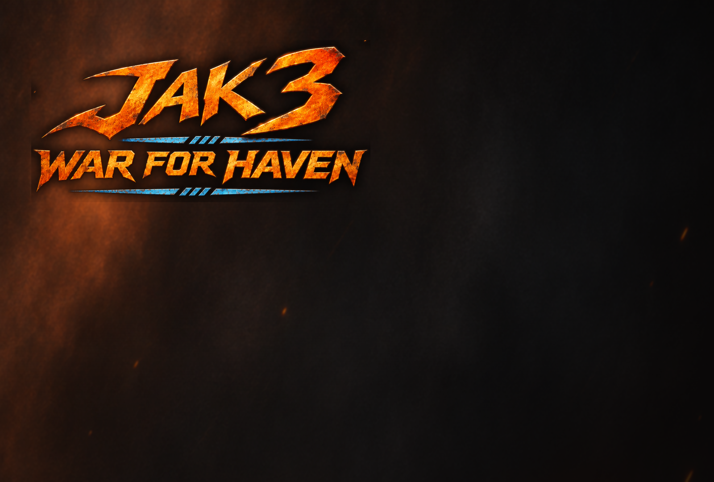

# War For Haven



**A Jak 3 mod for [OpenGOAL](https://opengoal.dev): Haven City becomes a three-way war between the Freedom League, the
KG Death Bots and the Metal Heads, Battlefront style. Hundreds of soldiers fight over command posts across the whole
city, and you fight in it as a Freedom League soldier, alone or with a friend in online co-op.**

**[Download the latest release](../../releases/latest)** · Windows · Requires your own copy of Jak 3

---

## What it is

The whole city is one battlefield. Every district is loaded at once and every soldier in it is real: the fight at the
Slums goes on while you are at the Port, and when you get there it is still going. Each side holds command posts,
sends its army at the posts it wants, and defends the ones it is losing. Each side has a limited number of
reinforcements. A side that runs out of men and posts is out of the war, and the last side standing wins.

You play as a Freedom League soldier. Pick a post to deploy at and a kind of soldier, join the push, call a squad to
follow you, take posts, and when you go down, deploy again.

## Features

**The war**
- Three armies at full strength at once: the Freedom League, the KG Death Bots and the Metal Heads, each with its own
  soldiers, weapons and headquarters.
- 21 command posts across the Port, the Industrial Zone, the Slums, the Ruins and the Metal Head Nest.
- Battlefront-style capture. Outnumber a post's holders inside its circle and its control drains away. The post goes
  white (nobody's) until one side holds it alone long enough to fill it. Headquarters hold out longer.
- Reinforcements come on at a side's posts, a little more often where they are needed (a post under attack, the
  front line) and from all of its posts, so the flow of fresh troops is never one crowd.
- Armies choose their own targets, split their attacks across fronts, and send defenders back when a post is in danger.
- The war keeps going everywhere, not only near you. The war map shows every army and every post as it happens.

**You, the soldier**
- Three kinds of Freedom League soldier, chosen on the deploy screen:
  - **Rifleman**: six shots, long reach.
  - **Tazer**: shock staff, deadly up close.
  - **Grenadier**: two grenades a load, breaks up crowds.
- A squad of League guards that follows you when you call it (Select) and joins the attack when you dismiss it.
- Three hits and you are down: pick a post and deploy again, as long as your side has posts and men.
- Hellcats and League bikes, armed, for you and for the armies. The KG also send giant Blast Bots at enemy posts.

**Co-op**
- Two players, one war. One player hosts and the other joins over the internet.
- Each player can be anywhere in the city. Both of you see the whole war: every soldier, shot, sound, effect,
  vehicle and Blast Bot, exactly as in single player.
- Your co-op name shows over your soldier in the other player's game.

**Screens**
- A deploy screen with the war map, your choice of post and soldier, and a live preview of each kind.
- A HUD with each side's remaining men and posts, a minimap, and the war clock.
- The war map (L3), an explanation of how the war works (R3), and a victory or defeat screen when it ends.

## Requirements

- Windows 10 or 11 (64-bit).
- Your own copy of Jak 3 as a PS2 disc image (`.iso`). The game is not included; it is built from your disc.
- About 12 GB of free disk space, 8 GB of RAM or more, and a graphics card with OpenGL 4.3.
- A controller is best. A keyboard works too.

## Install: OpenGOAL launcher (recommended)

The [OpenGOAL launcher](https://opengoal.dev) installs War For Haven and keeps it up to date.

1. Install Jak 3 in the launcher as usual (it asks for your Jak 3 `.iso`).
2. Go to **Settings > Mods**. In **Mod Source URL** paste this and click **Add**:

   ```
   https://raw.githubusercontent.com/Destroyer13579/war-for-haven/main/mods.json
   ```

3. Open **Jak 3 > Features > Mods**, pick **War For Haven** under Available Mods and install it.
4. Play it from its page in the launcher.

New versions show up on the same page: click **Update**.

Playing co-op from the launcher? Joining a friend takes one small text file: see [Co-op](#co-op) below.

## Install: zip

1. Download `War-For-Haven-vX.Y.Z.zip` from the [latest release](../../releases/latest).
2. Right-click it, choose **Extract All...**, and extract it somewhere simple such as `C:\Games`. You get a folder
   called **War For Haven**.
3. Double-click **`1 - Install War For Haven.bat`** and pick your Jak 3 `.iso` (or drag the `.iso` onto the `.bat`).
   It builds the game from your disc. This takes 5 to 30 minutes.
4. When it says DONE, it offers a desktop shortcut. Play with **`2 - Play War For Haven.bat`** or the shortcut.

If Windows shows "Windows protected your PC", click **More info** and then **Run anyway**.

## Play

1. Skip the opening movie with Triangle (R on the keyboard).
2. At the title press Start (Enter). Choose **WAR FOR HAVEN**, the top line, and press X (Space). Do not choose Load
   Game.
3. Pick a save slot: press X. If it asks to overwrite, press Left for Yes, then X.
4. The war starts and the deploy screen comes up. Pick your post (left/right) and soldier (up/down), then press X
   to deploy.

The first time the game starts, Windows Firewall may ask about `gk.exe`. Tick both **Private** and **Public** and
click **Allow**: co-op needs it.

## Co-op

One player hosts the war and the other joins it. Your PCs connect over a free virtual network both of you run:
[Radmin VPN](https://www.radmin-vpn.com) (recommended: no account, low lag) or LogMeIn Hamachi.

**Once, both players:**
1. Install Radmin VPN.
2. The host creates a network in it (Network > Create network) and sends the other player its name and password.
3. The other player joins it (Network > Join network). The host's PC now shows in the list with an address like
   `26.123.45.67`. That is the host's address.

**To host:** nothing to set up. Start the war as usual, and on the deploy screen press **Square** (F). The co-op line
says HOSTING, WAITING FOR A GUEST. When the other player is in, it shows their name and ping.

**To join:** your game needs the host's address once.

*Installed with the OpenGOAL launcher:*
1. Press **Windows key + R**, type `%APPDATA%\OpenGOAL` and press **Enter**. A folder opens.
2. In it, right-click > **New** > **Text Document**, open it, type the host's address (like `26.123.45.67`) on the
   first line, and save it.
3. Name the file `coop.txt`. If your other files don't show ".txt" at the end of their names, Windows is hiding
   extensions: then name it just `coop` (otherwise it becomes `coop.txt.txt` and the game won't find it).
4. Start War For Haven from the launcher as usual.

*Installed from the zip:* double-click **`3 - Join a Co-op War.bat`**, type the host's address once (it is saved), and
it starts the game.

Then start the war, and on the deploy screen, once the host is hosting, press **Triangle** (R). The co-op line says
JOINING, then IN ...'S WAR with a ping. To join someone else later, change the address in the file (or run the `.bat`
again).

Circle (E) leaves co-op. Without a virtual network, the host can forward UDP port **26210** on their router and the
other player joins the host's public IP instead. Both players need the same version of War For Haven.

**Your co-op name** is the first line of `name.txt`: in `%APPDATA%\OpenGOAL` (as above) for the launcher, or in the
**War For Haven** folder for the zip. It starts as your Windows user name.

## Controls

| Action | Controller | Keyboard |
|---|---|---|
| Move | Left stick | W A S D |
| Camera | Right stick | I J K L |
| Jump / deploy / OK | X | Space |
| Fire | R1 | O |
| Kneel and aim | L1 | Q |
| Stand and aim | L2 | 1 |
| Rifle butt (melee) | Square / Circle | F / E |
| Call or dismiss your squad | Select | ' |
| War map | L3 | , |
| How the war works | R3 | . |
| Pause | Start | Enter |
| Co-op on the deploy screen | Square host, Triangle join, Circle leave | F, R, E |

The keyboard works when no controller is plugged in. Controls can be changed in the game's options.

## Problems

If something goes wrong, open an [issue](../../issues) and attach the game's logs:
- Launcher: the log folder (Help > Open Log Folder in the launcher).
- Zip: the `data\log` folder inside **War For Haven**.

## Credits

- War For Haven by Destroyer13579.
- Built on [OpenGOAL](https://github.com/open-goal/jak-project) by the OpenGOAL team (ISC license).
- Co-op networking uses [ENet](http://enet.bespin.org) by Lee Salzman (MIT license).
- Jak 3 is by Naughty Dog. This is a fan project, not affiliated with Naughty Dog or Sony. You need your own copy of
  the game; none of its data is included here.
